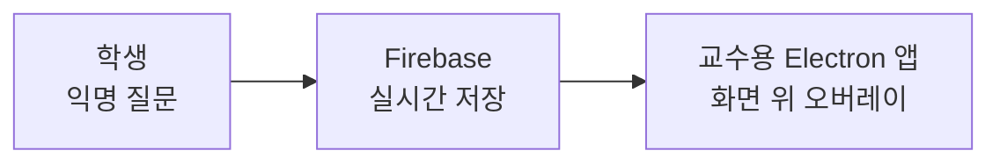

# 🙋 SHydent · 수업 중 익명 질문 시스템

6인 팀 프로젝트 (2025.03 ~ 06). 수업 중 학생이 교수에게 익명으로 질문하고, 교수용 Electron 앱이 질문을 화면 위 투명 오버레이로 띄웁니다.

| 항목 | 내용 |
|---|---|
| 기술 | Electron, Vite, Firebase |
| 내&nbsp;담당 | 학생용 앱 설계, GitHub 데이터 관리, 웹 · 앱 통합 |
| 소스&nbsp;코드 | 팀 저장소에 있으며, 팀원 동의를 받은 뒤 이곳에 올릴 예정 |
